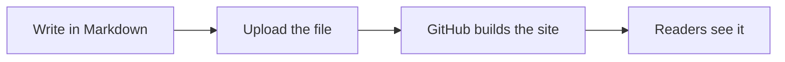

This article shows what you can add to a page beyond plain text. Every feature works with ordinary Markdown, and none of them needs a plugin.

## Diagrams

Write the diagram as text in a `mermaid` block and it is drawn for you, in the colours of the current theme.

## Maths

Put a formula between dollar signs, such as $e^{i\pi} + 1 = 0$, or on its own lines for a larger display:

$$
\frac{-b \pm \sqrt{b^2 - 4ac}}{2a}
$$

Prices like $5 and $10 stay as ordinary text.

## Videos

A video stays a plain button until you press it, so nothing is loaded from a video site by default.

@[youtube](aqz-KE-bpKQ "Big Buck Bunny — an open-source film")

## Pictures that follow the theme

If a picture named `diagram-light.svg` has a twin called `diagram-light.dark.svg`, the right one is shown in light or dark mode.

## Hints for hard words

The first mention of a term from the glossary, such as Markdown or RSS, shows its meaning when you hover over it or tab to it.
